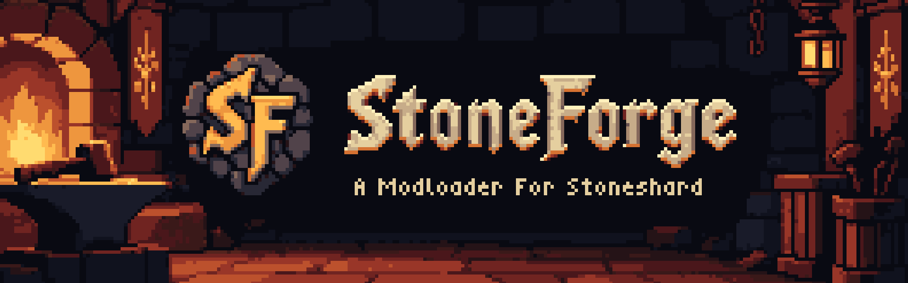

<p align="center"></p>

StoneForge is a mod loader for Stoneshard. Mods are written in C#, dropped into the game's `mods` folder, and switched
on and off in game from the **Mods** button on the main menu. It also runs MSL (`.sml`) mods.

## Requirements

- Windows, and Stoneshard on Steam. StoneForge works on both the default branch and the modbranch.
- The **.NET 10 Windows Desktop Runtime (x64)**. The installer tells you if it's missing.

## Install

1. Download `StoneForge-<version>.zip` from [Releases](https://github.com/StoneForgeTeam/StoneForge/releases) and
   extract it.
2. Close Stoneshard and run **Install StoneForge.cmd**.
3. Start the game as usual. The main menu now has a **Mods** button.

To update, install a newer release the same way. **Uninstall StoneForge.cmd** restores the game's own files and keeps
your mods.

Steam updates and "Verify integrity of game files" switch StoneForge off until you install it again. To have it put back
automatically, set Stoneshard's launch options in Steam (right-click Stoneshard > Properties > General) to:

```
"<your Stoneshard folder>\dotnet\patcher\StoneForge.Patcher.exe" run %command%
```

## Mods

Each mod is a folder in `<Stoneshard>\mods`. Open **Mods** on the main menu to enable or disable them. A mod that
asks for full access (network, its own DLLs) only runs once you've allowed it there.
Mods that include GML of their own only run on the modbranch.

**MSL mods** (`.sml` files, modbranch only): put them straight into `<Stoneshard>\mods` and start the game. They're
enabled by default and run unrestricted code, so only use ones you trust. No separate MSL install is needed:
StoneForge includes MSL 0.13.2 and [MSL Enhanced](https://www.nexusmods.com/stoneshard/mods/103). If one fails to
apply, the reason is in `<Stoneshard>\dotnet\msl-patch.log`.

## Your saves

Before the game writes over or deletes a save, StoneForge backs it up to
`%LOCALAPPDATA%\StoneShard\StoneForge\save-backups\<character>\`, keeping the 20 most recent per character. If a mod
hits an error, StoneForge also keeps a copy of the save you're playing and asks whether to quit to the main menu
without saving.

To restore a backup, close the game and copy its folder into `%LOCALAPPDATA%\StoneShard\characters_v1\<character>\`,
renamed to the save's own name (for example `autosave_1`).

## Reporting bugs

Use **Report a bug** in the game's Escape menu: it can attach your recent log. Or open an issue on this repository.

## Writing mods

The documentation is in [StoneForgeDocs](https://github.com/StoneForgeTeam/StoneForgeDocs), and
[ExampleMod](https://github.com/StoneForgeTeam/ExampleMod) is a complete sample. Mods can add items, consumables,
buffs and skills; hook the game's scripts and events; build UI; and add
[quests and contracts](https://github.com/StoneForgeTeam/StoneForgeDocs/blob/main/docs/world/quests-and-contracts.md),
[NPC dialogues](https://github.com/StoneForgeTeam/StoneForgeDocs/blob/main/docs/ui/npc-dialogues.md) (with an in-game
editor) and [translations](https://github.com/StoneForgeTeam/StoneForgeDocs/blob/main/docs/core/localization.md).

Start with [writing a mod](https://github.com/StoneForgeTeam/StoneForgeDocs/blob/main/docs/modding/writing-a-mod.md).
To let players report bugs for your mod from the Escape menu, add your GitHub repository to its `mod.json`:

```json
"github": "YourAccount/YourMod"
```

Reports are delivered through [BugDrop](https://github.com/mean-weasel/bugdrop), so the repository needs BugDrop set up
to receive them.

## Building from source

You need the .NET 10 SDK, Visual Studio with the C++ tools (toolset `v145`), and Stoneshard installed (the API is
generated from your copy of the game's data). From a Visual Studio developer PowerShell:

```powershell
msbuild StoneForge.slnx -restore -p:Configuration=Release -p:PlatformToolset=v145
dotnet test StoneForge.Tests -c Release --no-build
powershell -ExecutionPolicy Bypass -File build/Package.ps1 -NoBuild
```

See [building and testing](https://github.com/StoneForgeTeam/StoneForgeDocs/blob/main/docs/development/building-and-testing.md)
for the details.

Without the game, the tests can run on small stand-in data, as the [Tests workflow](.github/workflows/tests.yml) does
for every pull request: `dotnet test StoneForge.Tests -c Release -p:StoneForgeStubGameData=true`. It only holds the game
names StoneForge itself uses, so if your change uses another one (`GameObjectId.x`, `Scripts.x`...), add it to
`build/StubGameData`. Never package a build made this way.

Releases are published by the maintainers ([RELEASING.md](RELEASING.md)).

## License

StoneForge's license is in [LICENSE](LICENSE). Bundled third-party components have their own licenses, listed in
[THIRD-PARTY.txt](build/release/LICENSES/THIRD-PARTY.txt). Stoneshard and its game data belong to their respective
owners. See [CHANGELOG.md](CHANGELOG.md) for what's changed in each version.
